# A tour of the kit: what every app gets

An app built on o3-sdk writes its own engine: its units, its screens, its controls. Everything on this page comes with the kit, in every app,
without a line of the app's code beyond the few named in each section. Each section has its picture, what it shows, where it stands on the
unit, and a link to the reference (`FRAMEWORK.md`) or the tutorial (`NEW-APP.md`).

The pictures are the simulator's, taken by the kit's own scenarios: HELLO (`apps/hello`, the kit's example app) and the template app that
`tools/new_app.py` writes. They are the FT812 display list drawn on the host, 800 x 480, not photographs of a unit. The unit's own screenshot
(`o3console.py --shot`) has the same layout; its colours differ from the simulator's, which is still open (`FRAMEWORK.md` section 10, Display).
How to make them again is at the end.

1. [Your app on day one](#1-your-app-on-day-one)
2. [The boot logo](#2-the-boot-logo)
3. [The frame](#3-the-frame)
4. [HELP on every screen](#4-help-on-every-screen)
5. [The system Config](#5-the-system-config)
6. [The name keyboard](#6-the-name-keyboard)
7. [The file picker](#7-the-file-picker)
8. [Files on the card](#8-files-on-the-card)
9. [Recording](#9-recording)
10. [MIDI](#10-midi)
11. [USB audio](#11-usb-audio)
12. [Three themes](#12-three-themes)

Then [under the hood](#under-the-hood): the diagrams and the recipes; and [how to make the pictures again](#make-the-pictures-again).

## 1. Your app on day one

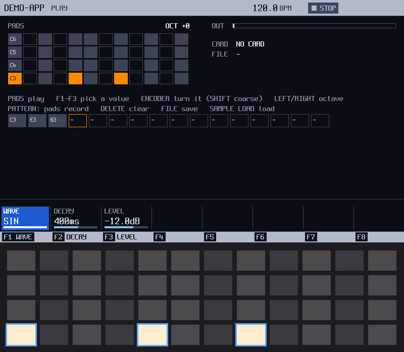

`python3 -I tools/new_app.py ../myapp myapp --name MYAPP`, one build, and this runs (the picture's app is named DEMO-APP): one screen, one unit (VOICE, three values on F1..F3), a
chord held on the pads (C3, E3, G3) and recorded into a 16-step pattern that FILE saves to the card. Under the screen the simulator draws the
48 pads with their LED levels: the held pads full, the white keys dim. Every file it writes is yours to change: the app and its unit are
under 900 lines, comments included.

On the unit: the template's image is built and checked by `ctest -L template` (host and mk66); it has never run on a unit.
Read: `NEW-APP.md` [section 1](NEW-APP.md#1-create-the-repository), `FRAMEWORK.md` [section 11](FRAMEWORK.md#11-using-o3sdk-from-another-project).

## 2. The boot logo

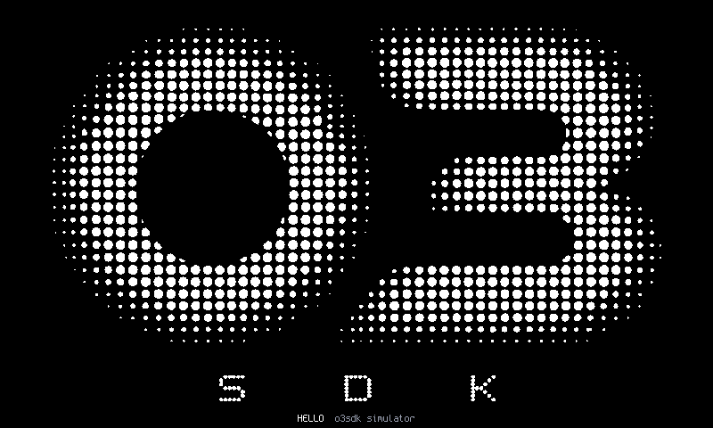

The first frame the display shows, before the app's screen: the logo centred on black, the app's name and the build line under it (here the
simulator's). The kit's default is the O3 halftone; `o3sdk_app(... LOGO my_logo.png)` gives an app its own, converted at build time.

On the unit: in every image; seeing it needs eyes, a check of the pending card session (`docs/hw/2026-10-25.md`, M2-2). Read: `NEW-APP.md`
[The boot logo](NEW-APP.md#the-boot-logo), `FRAMEWORK.md` [section 11](FRAMEWORK.md#11-using-o3sdk-from-another-project).

## 3. The frame

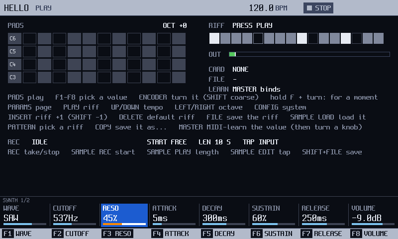

| Region | Size | Whose |
|---|---|---|
| Header | 800 x 32 | the kit's: the app's name, the screen's `title()`, the tempo and the transport (an app without a sequencer drops them with `App::header()`), the render's load on the unit |
| Content | 800 x 426 | the screen's `draw(ctx, r, area)` |
| System strip | 28 px over the bottom of the content | the kit's: a save, a refusal, the power-off hold; it appears only when there is something to say (section 8 shows it) |
| Soft keys | 800 x 22 | drawn by the kit from the screen's `soft_keys()`: eight labels, a hot one, dimmed ones |

HELLO's PLAY screen with F3 held and the encoder turned: RESO is the focused cell while F3 is down, and at the release the encoder goes back to
CUTOFF, which a tap on F2 latched. The eight cells are `app::knob_strip()` over `app::ParamKeys`: the controls convention every kit app shares.

On the unit: every frame is drawn, `--shot` returns it clean; not looked at by eye yet. Read: `FRAMEWORK.md`
[the controls convention](FRAMEWORK.md#the-controls-convention-param_keysh), [section 6](FRAMEWORK.md#6-the-runtime).

## 4. HELP on every screen

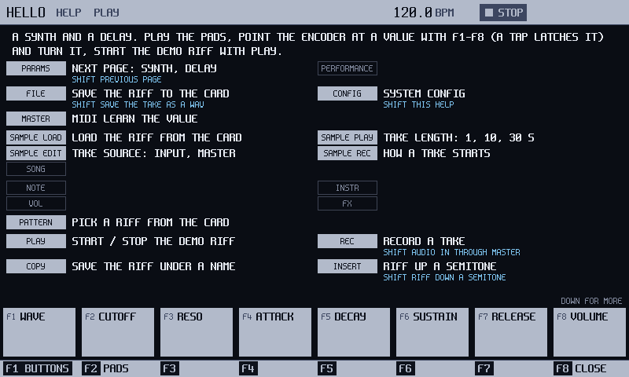

Shift held, Config pressed, on any screen: the kit draws what the buttons do there, from one `Help` the screen fills in `Screen::help()`. The
F row is eight key caps with their longer texts, the other buttons are in their printed groups with their Shift line under them where there
is one, and a button the screen does not use is a hollow, dim cap. CONFIG describes itself; the app never sees that button.

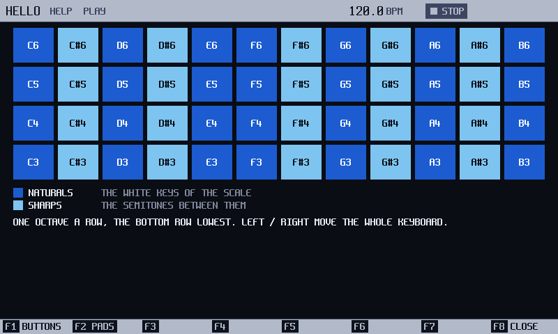

F2 turns to the pads: the grid in its groups' colours, a label on each pad, the legend and one line under it. HELLO's keyboard is filled by
`help_pad_note()`, so the labels move with the octave. F8 or Config closes it; the sound never stops underneath.

On the unit: host only (the pad labels at arm's length are a unit check). Read: `FRAMEWORK.md`
[Help](FRAMEWORK.md#help-shift--config-helph-help_overlayh), [Give your app HELP](FRAMEWORK.md#give-your-app-help).

## 5. The system Config

Config, in every app, opens the kit's screen over the app's: the app keeps running and sounding underneath, and gets no new press or turn
until it closes. LEFT / RIGHT change the section, F8 goes back, Config closes. A section appears only when the platform has its hardware, so
the simulator shows each one in the run that gives it the fake: the tabs differ from picture to picture.

On the unit: FIRMWARE, DISPLAY and INFO opened and worked over USB injection on 2026-10-26 (reported by the tester); the final INSTALL from the
screen needs a finger and is not verified; AUDIO, MIDI, CARD, DISPLAY's brightness rows and the app's pages are host only. Read: `FRAMEWORK.md`
[The system Config](FRAMEWORK.md#the-system-config-the-kits-in-every-app).

### FIRMWARE

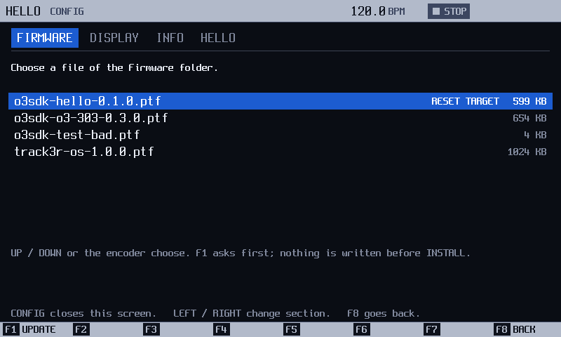

"Por defecto config lleva el flasheo de otro firmware" (the maintainer, 2026-10-25): any engine can switch the unit to another. The list is the
`.ptf` images of the card's `Firmware/` folder; RESET TARGET marks the first, the one the bootloader's reset button flashes. F1 asks first, and
nothing is written before INSTALL.

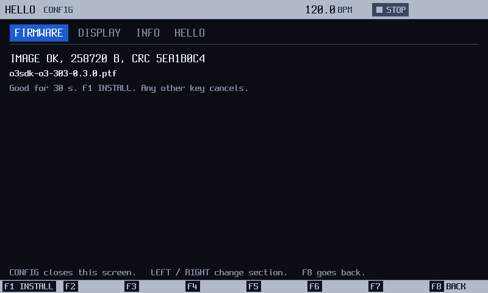

F1 again checks the image in slices; a third F1 at IMAGE OK installs it through the same update path as the USB console. Any other key cancels.

### AUDIO

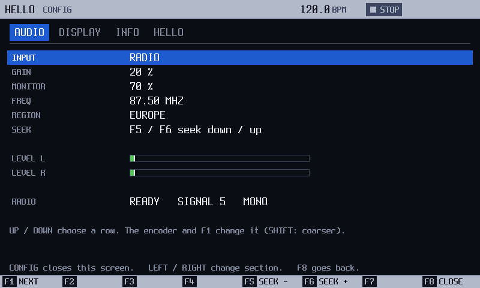

The input (line, microphone, the FM radio, the computer's USB return), its gain, the monitor into the master and a level per channel; with the
radio, its frequency and region, and F5 / F6 seek. Here the simulator's receiver is ready on 87.50 MHz.

### MIDI

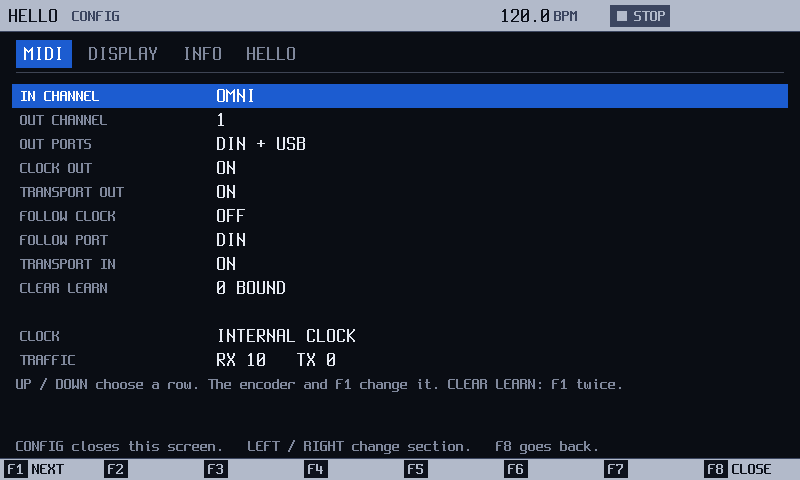

The user's MIDI: the channels and ports, clock and transport out, following a master's clock (section 10), CLEAR LEARN for every controller
bound with MIDI learn, and the traffic counters. The app never draws this; it reads `ctx.midi().config()` if it needs to.

### CARD

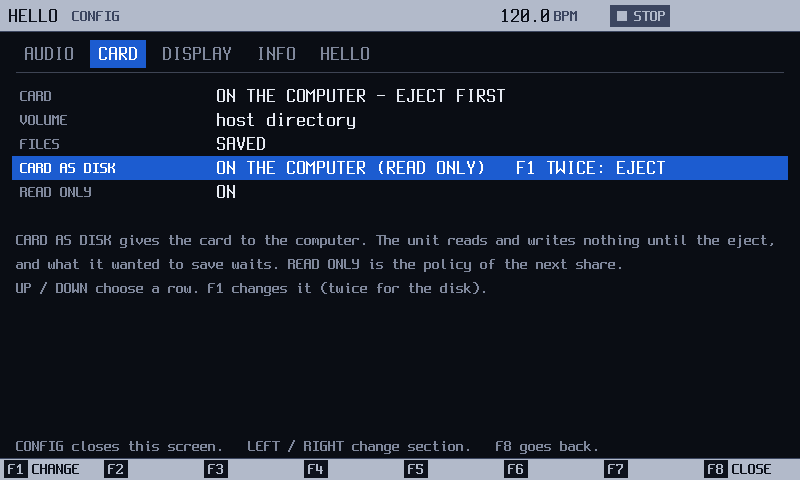

The card as the files service sees it, the last job, and CARD AS DISK: F1 twice gives the card to the computer over USB (read only by default)
and the app's saves wait until the eject. Here the card is on the computer.

### DISPLAY

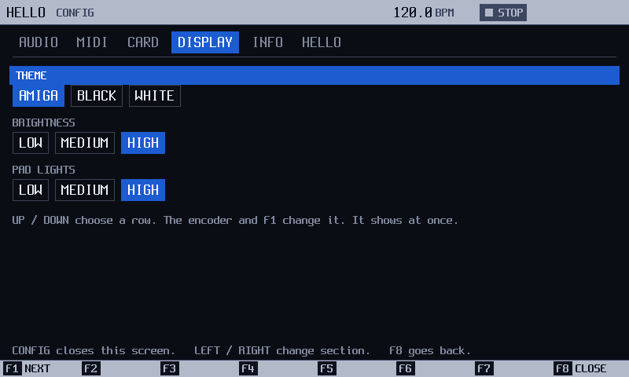

The theme (section 12), the backlight and the pad LEDs' brightness. It shows at once, and the kit keeps it on the card for the app
(`Apps/<id>/system.o3s`).

### INFO

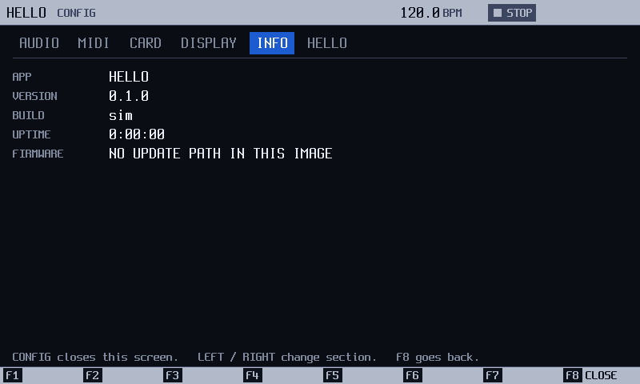

What the unit runs: the app's name and version from `App::info()`, the build, the uptime and, on the unit, the last crash record. This run had
no update path, and the FIRMWARE line says so.

### The app's own page

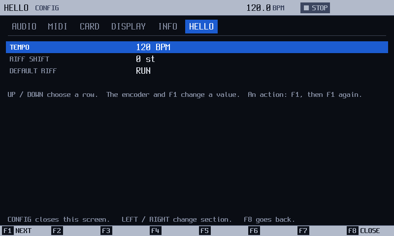

An app adds up to four tabs of up to eight rows: a value (a `core::ParamDesc`, which the encoder and F1 change) or an action (F1, then F1 again).
HELLO's has TEMPO, RIFF SHIFT and DEFAULT RIFF; the kit keeps the values on the card. The recipe: `COOKBOOK.md`
[Add a Config page](COOKBOOK.md#5-add-a-config-page-for-the-app).

## 6. The name keyboard

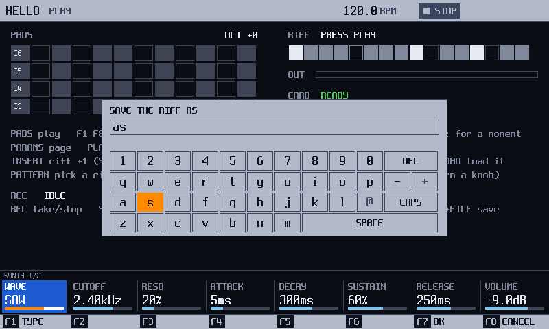

`app::NameEntry`, a dialog over any screen: the keyboard is the pads' grid, one key a pad, so a name is typed with the pads (here pad 24 typed A
and pad 25 typed S). The encoder moves the focus and F1 types the focused key, DELETE erases, F7 is OK, F8 CANCEL; keys a file name cannot
hold are dimmed.

On the unit: host only. Read: `FRAMEWORK.md` [The list and the keyboard](FRAMEWORK.md#the-list-and-the-keyboard-kitui-list_viewh-keyboardh).

## 7. The file picker

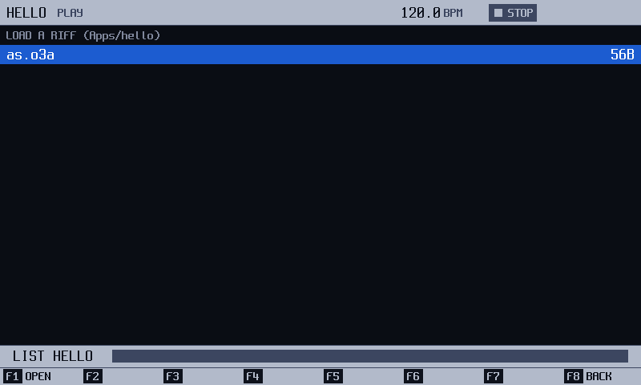

`app::FilePicker` lists a folder of the card through `Files::list` over `ui::ListView`, keeps one extension, and answers Chosen or Cancelled.
HELLO's PATTERN key opens it on `Apps/hello/`; F1 OPEN, F8 BACK. The strip at the bottom is the listing job.

On the unit: host only. Read: `FRAMEWORK.md` [The system Config](FRAMEWORK.md#the-system-config-the-kits-in-every-app), its bullet
"Widgets for an app's screen".

## 8. Files on the card

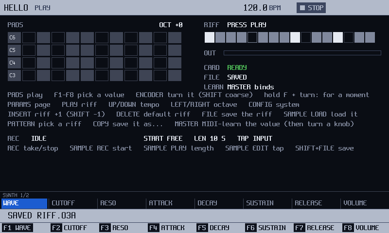

`ctx.files().save("", "riff.o3a", buf, n)` returns at once; the runtime runs the job a slice a pass (a budget of 2 ms), writes a temporary file,
reads it back, checks it and only then renames it over the old one, which stays as `.bak`. The kit's strip says SAVED RIFF.O3A for a few
seconds; HELLO's own FILE line says SAVED. On the host, a cut at every write leaves the old file or the new one, never half of one; a card
pulled or the power cut during a save is not checked on the unit yet.

On the unit: the card's read path and the update path's writes are verified; the app file API is host only. Read: `FRAMEWORK.md`
[Files on the card](FRAMEWORK.md#files-on-the-card-filesh).

## 9. Recording

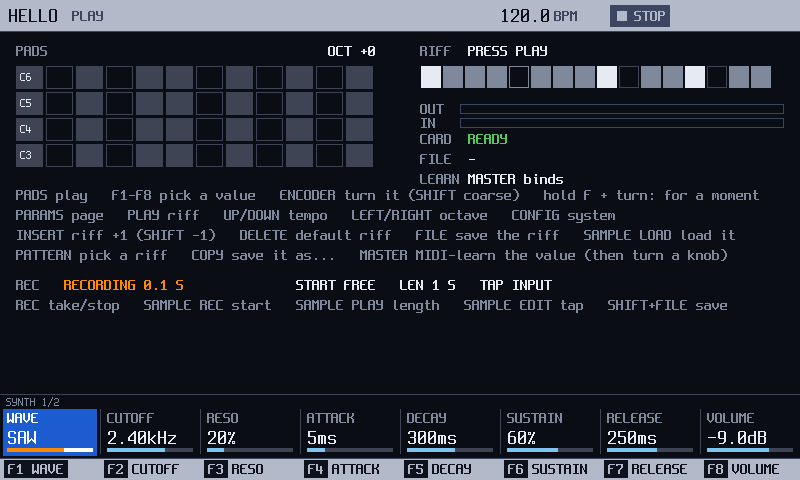

`ctx.recorder()` records the input or the master into a buffer the app owns (in the SDRAM), on the spot, on a step, a bar, a pattern or a level,
and saves the take as a WAV. Here a one-second FREE take of the input, 0.1 s in. The REC line and its keys are HELLO's own drawing: the kit
gives the recorder, not a screen.

On the unit: host only (the cost while recording and the input take's lag are unit checks). Read: `FRAMEWORK.md`
[Recording](FRAMEWORK.md#recording-recorderh-halrecordh).

## 10. MIDI

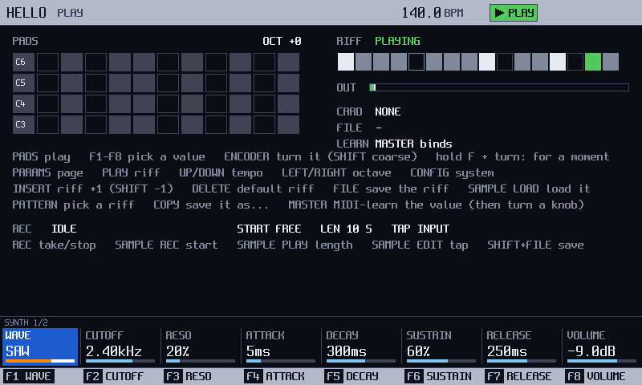

With FOLLOW CLOCK on in the Config, the engine's transport is a MIDI master's: here 140 BPM and playing, and HELLO's riff, a clocked hook,
follows with no code of its own for it. Notes reach a unit through `ctx.midi().route(unit, channel)`; every channel message no route took
goes to `App::midi()`.

On the unit: host only (the DIN and USB drivers are built, not run on a unit). Read: `FRAMEWORK.md` [MIDI](FRAMEWORK.md#midi-midih).

## 11. USB audio

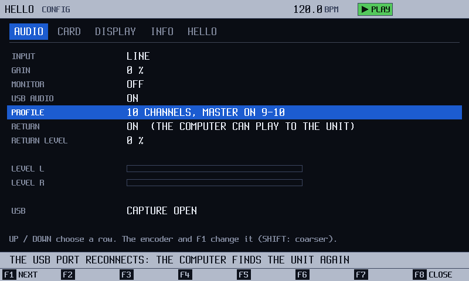

The unit is a class-compliant USB audio interface next to its console. PROFILE chooses the channels (here 10, the master on 9-10 and a stem
per slot on the others), RETURN lets the computer play to the unit, RETURN LEVEL mixes it in. The strip says the port reconnects with the
new set.

On the unit: the boot layout (8 channels, the master on 7-8) is verified and recorded; the other profiles, the stems, the return and the disk
are host only. Read: `FRAMEWORK.md` [USB audio](FRAMEWORK.md#usb-audio-and-the-card-as-a-disk-usb_audioh-halusb_audioh).

## 12. Three themes

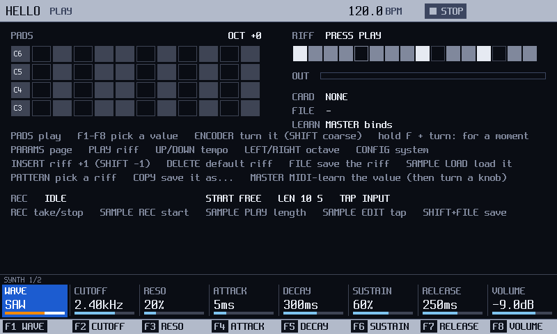

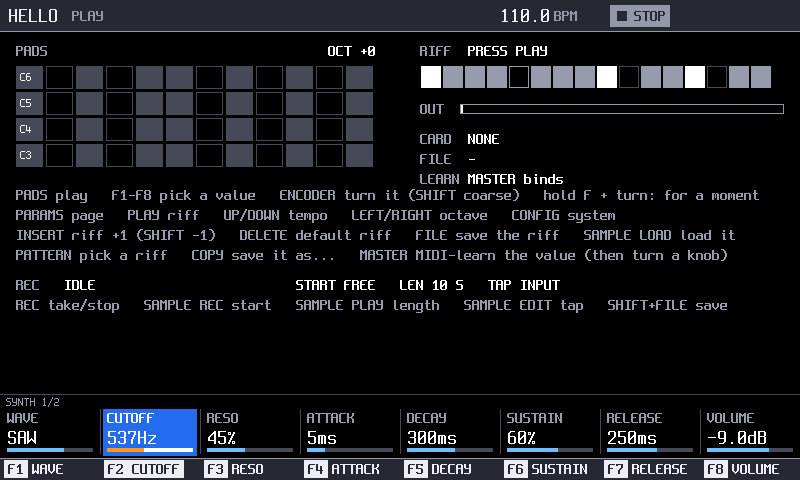

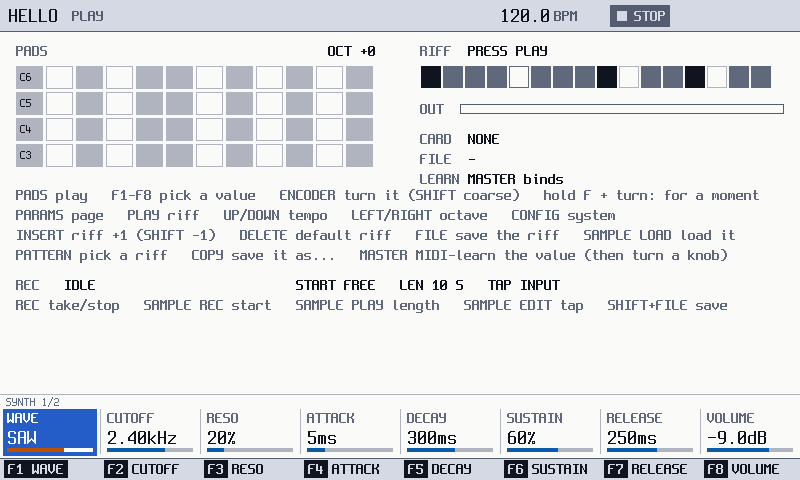

A screen draws with colour tokens (`Color::Pane`, `Text`, `Accent`, `Play`, ...) and the four faces (`Display`, `Data`, `Label`, `Micro`),
never with RGB, so the kit's three themes, AMIGA (the default), BLACK and WHITE, change every app at once; the user picks one in Config,
DISPLAY. A screen may also name a `ui::Theme` of its own (`Screen::theme()`), as o3-303's obsidian skin does. (The BLACK picture is from later
in HELLO's tour: the tempo down to 110, CUTOFF latched.)

On the unit: the colours of the unit's screenshot differ from the simulator's (open). Read: `NEW-APP.md` [section 4](NEW-APP.md#4-add-a-screen).

## Under the hood

`FRAMEWORK.md` draws the machinery behind these pictures, from the code:

- [the layers and their link dependencies](FRAMEWORK.md#2-layers);
- [an app's life, one pass of the main loop and who gets a press, a frame from `Screen::draw` to the FT812, and the real-time
  split](FRAMEWORK.md#6-the-runtime) between the render and the main loop.

`COOKBOOK.md` has the recipes: a unit, a parameter, a screen, HELP, a Config page, a console command, bitmaps, files, MIDI, a take, a
scenario, the CPU.

## Make the pictures again

One table in `tools/doc_images.py` maps each picture to its scenario, its snap and its crop; the script runs the scenarios with the card, firmware
folder and audio-in options the kit's digest ctests give them, and writes `docs/img/`.

```sh
cmake -S . -B build-host && cmake --build build-host -j4
ctest --test-dir build-host -R template_host_build        # builds the template app and its simulator
python3 -I tools/doc_images.py --build build-host         # runs the scenarios, writes docs/img/*.png
python3 -I tools/doc_images.py --check                    # what the ctest doc_images runs
```

`--check` needs no build: every picture a document shows exists and has a row, every row names a scenario and a snap that scenario takes, and
nothing in `docs/img/` is left over. It never compares pixels: the frame digests (`tests/digests/`) are what pin the drawing.
